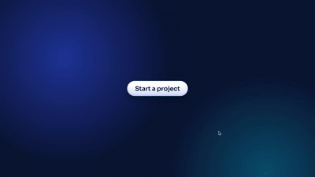

<div align="center">



<a href="https://visqora.app/">
  
</a>

<p>
  <a href="https://visqora.app/"></a>
  <a href="mailto:visqora@gmail.com"></a>
  <a href="https://github.com/Visqora"></a>
</p>

</div>

---

## 👁️ who we are

**VISQORA** is a tech studio for businesses that are ready to level up.
strategy, design, engineering and AI all under one roof. you bring the idea, we take it
from *first sketch* → *launched product*. simple as that. ✌️

## 🛠️ what we cook

| | the service | the vibe |
|:--:|:--|:--|
| 💻 | **Web & Mobile Dev** | fast, scalable sites + apps that just *hit different* |
| 🧠 | **AI & Computer Vision** | turning data & visuals into big-brain decisions |
| ☁️ | **Cloud & DevOps** | infra that never sleeps, deploys that never flop |
| 🎨 | **UI/UX Design** | clean, user-first, main-character energy interfaces |
| 📊 | **Automation & Analytics** | workflows on autopilot, insights on tap |

## ⚡ how we move

<div align="center">

```
  🎨 DESIGN   ──▶   💻 DEVELOP   ──▶   🚀 DEPLOY
```

*every build starts with understanding the problem and ends with a product that slaps.*

</div>

## 🧰 our stack

<div align="center">
  
</div>

## 🌍 why VISQORA tho?

we see beyond the obvious. our logo is an **eye** 👁️ + a **globe** 🌍 + an **aperture** 📸
= **perception**, **global perspective** & **precision**. pair that with modern engineering and
you get tech that's smart, precise, and built to last. fr. 💯

## 🫶 the founders

<div align="center">
<table>
  <tr>
    <td align="center" width="240">
      <a href="https://github.com/aad1tyaaaaa">
        
      </a>
      <br /><b>Aaditya Jaiswar</b>
      <br /><sub>co-founder & owner 👑</sub>
      <br /><a href="https://github.com/aad1tyaaaaa">@aad1tyaaaaa</a>
    </td>
    <td align="center" width="240">
      <a href="https://github.com/omkarbandikatte">
        
      </a>
      <br /><b>Omkar Bandikatte</b>
      <br /><sub>co-founder & owner 👑</sub>
      <br /><a href="https://github.com/omkarbandikatte">@omkarbandikatte</a>
    </td>
  </tr>
</table>
</div>

## 💬 let's build something

got an idea that's ready to glow up? we're literally one message away.

<div align="center">

[](https://visqora.app/)
[](mailto:visqora@gmail.com)

</div>

<div align="center">
  
  <sub>© 2026 VISQORA · made with 💙 & way too much coffee ☕</sub>
</div>
